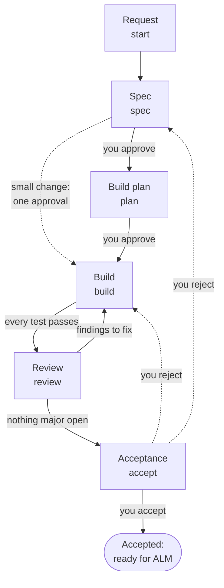

# Logic Fabric for Dataverse

Build Logic Fabric for Dataverse solutions the way software is built. You describe what the business needs; Claude
writes a spec in Logic Fabric terms for you to approve, then a build plan with its tests for you to approve, then
builds the logic blocks, flows, business processes, recipes, events, schedules, service connections and Dataverse
tables, tests them, has them reviewed, and shows you the results to accept. It can also document, govern, analyze
and security-review the projects you already have.

Claude works through your organization's **Logic Foundry** server, signed in as you. It can only see and change
what your Dataverse user can, and it builds only in development: test and production change through your
solutions and pipelines.

## Before you start

You need:

- **The address of your Logic Foundry server**, ending in `/mcp`, for example
  `https://<app>.<region>.azurecontainerapps.io/mcp`. Your administrator can give it to you.
- **A Dataverse user** with Logic Fabric author privileges in the development environment.
- **Claude Code** and **Node.js 18 or later** (the workflow's hooks run on Node.js).
- **A git repository** for your Logic Fabric work, usually your solution's ALM repository.
- **The Logic Fabric CLI plugin** (`flowon-dynamics`), optional: Claude uses it to export, import and deploy
  solutions and to set up your pipelines.

Your administrator also needs to set up sign-in once for your organization: see
[Set up sign-in](#set-up-sign-in-administrators).

## Install

1. Add the marketplace and install the plugin, and the Logic Fabric CLI plugin if you deploy with the CLI:

   ```bash
   claude plugin marketplace add flowon-official/ai-plugins
   claude plugin install logic-fabric-dataverse@flowon
   claude plugin install flowon-dynamics@flowon
   ```

2. When Claude Code asks for the **Logic Foundry MCP endpoint**, enter your server's address. You can change it
   later in `/config`.
3. Restart Claude Code, run `/mcp`, select **plugin:logic-fabric-dataverse:foundry** and choose to sign in. Sign in
   with your work account in the browser window that opens.

## Codex and GitHub Copilot

The plugin works the same way in OpenAI Codex and in GitHub Copilot (the Copilot CLI, and Visual Studio Code, which
uses the plugins the CLI installed). It needs Node.js 18 or later there too.

1. Install it:

   ```bash
   copilot plugin marketplace add flowon-official/ai-plugins     # GitHub Copilot
   copilot plugin install logic-fabric-dataverse@flowon

   codex plugin marketplace add flowon-official/ai-plugins       # Codex
   codex plugin add logic-fabric-dataverse@flowon
   ```

2. In your repository, run the plugin's `setup` skill with your Logic Foundry server's address:
   `/logic-fabric-dataverse:setup https://<app>.<region>.azurecontainerapps.io/mcp` in Copilot,
   `$logic-fabric-dataverse:setup ...` in Codex. In Copilot it writes the `foundry` server into the repository's
   `.github/mcp.json`; in Codex it adds it to your Codex configuration and copies the plugin's agents into
   `.codex/agents/`.
3. Sign in to `foundry`: Copilot asks when it first connects (trust the repository's folder when Copilot asks, or it
   doesn't load the repository's servers); in Codex, run `codex mcp login foundry` in your terminal. The GitHub
   Copilot app doesn't offer the sign-in for a repository's server: add the server once under **Customize**, with
   the address and client ID from `.github/mcp.json`, and sign in there. Give it a name with `foundry` in it (such
   as `Logic-Fabric-Foundry`): the plugin's hooks find Foundry's tools by that name.
4. **Codex only:** open `/hooks` and trust the plugin's hooks. Codex runs no plugin hook until you trust it, and asks
   again whenever the hooks change. Codex also loads the agents in `.codex/agents/` (named `logic_fabric_reviewer`
   and so on) only from a folder you trust. After a plugin update, run `setup` again to refresh them.

What differs from Claude Code:

- The commands are skills you run by name: `/logic-fabric-dataverse:plan approve` in the Copilot CLI, `/plan approve`
  in the GitHub Copilot app (its `/` menu lists them without the plugin's name), `$logic-fabric-dataverse:plan approve`
  in Codex. In Copilot you can pick the next step instead, as in Claude Code; Codex names it and takes it when you
  answer yes.
- Codex can't stop a command for your approval from a hook. A command the plugin would show you for approval (such as
  importing a security role with the Logic Fabric CLI) is refused instead, and the agent tells you the command to run
  in your own terminal.
- Copilot's cloud agent can't sign in to Logic Foundry, so the plugin doesn't work there.

Logic Foundry keeps the approvals and the stages for every client (see [Approvals](#approvals)); the plugin's hooks
add their checks where the client runs them.

## How a change is built

Every change goes through six stages, the way a software change does. Claude does the work in each stage and stops
at the gates for you: nothing is built until you approve what will be built, and nothing is finished until you
accept it.



| Stage | Command | What Claude does | Your part | Written to the change folder |
|---|---|---|---|---|
| Request | `start <request>` | Looks at what exists and asks the questions the spec depends on | Answer them | `request.md` |
| Spec | `spec` | Writes the requirements, who may run what, and the acceptance criteria | `spec approve` | `spec.md` |
| Build plan | `plan` | Orders the work into tasks and writes the tests that prove each one | `plan approve` | `plan.md`, `tests/` |
| Build | `build` | Validates, saves and tests each artifact, then tests everything together | | `artifacts/`, `build-log.md`, `test-report.md` |
| Review | `review` | Has the change reviewed independently against the spec and the rules | | `review.md` |
| Acceptance | `accept` | Runs the acceptance scenarios again and shows you the evidence | `accept accept`, or reject | `acceptance.md` |

Each command is `/logic-fabric-dataverse:<command>`. After `start` you rarely type one: when a stage is done, Claude
asks what to do next, with the next step as the first choice (ask Logic Foundry for your approval, commit the change
folder, start the next stage). Pick it and Claude runs it; an approval is still given in Logic Foundry's own dialog.
Run `/logic-fabric-dataverse:status` at any time to see the stage, which approvals still hold, the tasks done and
open, the last test run, the open review findings and the next step.

### Request

```
/logic-fabric-dataverse:start When a claim over $50,000 is reported, route it to the senior adjusters team and notify the claims manager
```

The first time, Claude creates `logic-fabric/workspace.yaml` in your repository: the Logic Fabric project, its
solution and publisher prefix, your environments, and the test users (personas) that check who may run what. It
asks you only which project. For a new project, it also asks for the solution and its publisher, an existing one or a
new one with its prefix, and the build plan creates them first.

Claude then reads what already exists: the artifacts the request touches, the tables and choices involved, the teams
and roles. It writes `request.md` with the request, what exists and could be reused, and its questions, and asks
the ones the spec can't do without (who may run it, thresholds, which records, what happens on failure) in one
message. Nothing is built or saved in this stage.

### Spec

`spec` writes `spec.md` in your business's words and Logic Fabric terms:

- the data model, with every table, column and choice value checked against Dataverse or declared new;
- one requirement per behaviour (`REQ-1`, `REQ-2`, ...), each naming the artifact that will do it, for example the
  flow `Claims_RouteHighValueClaim`;
- an access statement for every entry point: who may run it, under which condition, and what someone refused is
  told;
- acceptance criteria with concrete values: *Given a claim with an estimated loss of 50,001, when it is reported,
  then it is assigned to the Senior Adjusters team and the claims manager is notified.*

Claude checks the spec (criteria for every requirement, no missing column, role or team, no "to be decided") and
shows you a summary, then offers to ask for your approval (or run `/logic-fabric-dataverse:spec approve`): Logic
Foundry asks you to confirm in Claude Code's own dialog and records your approval (see [Approvals](#approvals)).
Claude then offers to commit the change folder and write the plan.

### Build plan

`plan` turns the approved spec into `plan.md`, one task per artifact, in the order they can be built: tables first,
then configurations and service connections, blocks before the flows that call them, business processes, and the
go-live steps last (enabling recipes and schedules, publishing processes, exposing agent tools). Each task lists its
inputs and outputs, its access rule, its tests and when it is done. A change to an existing artifact lists what uses
it, and their tests join the regression run.

It also writes the test cases in `tests/`: every acceptance criterion, the boundaries (50,000 and 50,001), the
failures, and for every access rule a user who may run it and one who may not.

The plan's summary tells you what will exist, what changes, what goes live and when, what is deleted, and the
risks. Pick the approval when Claude offers it (or run `/logic-fabric-dataverse:plan approve`), confirm in Foundry's
dialog, then let Claude commit and start the build.

### Build

`build` works through the tasks in order. For each one, Claude writes the metadata, has Logic Foundry validate it
and fixes what it reports, saves it to the development environment, and runs the task's tests. The source of every
saved artifact is written to `artifacts/`, so it is versioned and reviewed with the change. Go-live tasks run only
after the tests of what they make live have passed.

When every task is done, Claude runs all the change's tests and the regression set on fresh test data and writes
`test-report.md`, which traces each acceptance criterion to the tests that prove it.

If a task still fails after three attempts, Claude stops, marks it blocked with the error and tells you. If the
build needs something the plan doesn't have (a new artifact, a changed input, a table change), Claude adds it to
the plan and asks you to approve the plan again.

### Review

`review` gives the change to a reviewer agent that sees the artifacts, the spec and the plan, but not Claude's
opinion of its own work. It checks them against the spec, the plan and the rule catalog. A change to a business
process also gets a process analysis, and a change to who can run what gets a security review. Findings go into
`review.md` with their severity, where they are, the rule, the evidence and the fix. Every blocker or major finding
becomes a fix task: run `build`, then `review` again.

### Acceptance

`accept` runs the acceptance scenarios again on fresh test data, checks that what is in the development environment
matches `artifacts/`, and writes `acceptance.md`: each acceptance criterion with its evidence (records, outputs),
the test totals and the review's verdict. Then you decide, in Foundry's dialog (see [Approvals](#approvals)):

- **Accept** closes the change. Its tests join the regression set in `logic-fabric/baseline/tests/`, the
  requirements document is brought up to date, and the change is ready for ALM: export the solution and run your
  pipeline to take it to test and production.
- **Send it back to the build or to the spec**, with your reason. Back to the spec, its spec and plan approvals are
  cleared, so you approve both again before anything is built.

Without the Logic Fabric Foundry solution, you decide in the session: `/logic-fabric-dataverse:accept accept`, or
`accept reject spec` or `accept reject build` with your reason.

### Small changes

A change of at most two artifacts with no data model change (tables, columns, choices) is a small change: the
plan's tasks go at the end of the spec, and one approval covers both.

### Changing or removing what a change built

An accepted change is closed. To change or remove what it built, start a new change. When a plan deletes an
artifact, its summary names it (`Delete logicBlock Claims_CalculateHandlingFee: <reason>`), a task checks that
nothing uses it, a test checks that it is gone, and the regression tests that covered it are marked retired, so
they are skipped from then on instead of being deleted.

### What the plugin enforces

The plugin's hooks keep the workflow in place, whatever Claude is asked:

- Claude can change the development environment (save, delete, go live, run tests) only while a change is being
  built or fixed after review, and only against an approved plan (the approved spec, for a small change).
- Each approval is stamped with a fingerprint of the file you approved. If the spec or plan is edited afterwards,
  building stops until you approve it again. Ticking off a task doesn't count as an edit.
- A delete goes through only when the approved plan names it.
- The few tasks Foundry can't do, such as creating security roles with the Flowon command-line tool, Claude
  prepares, previews and runs itself after asking you: Claude Code shows you each such command for approval. They
  follow the same rules as Foundry changes, and a command aimed at a test or production environment is refused.
- Stages only move forward, except when you reject at acceptance, and a change can't retire its own tests to make
  them pass.
- At every prompt, Claude is told the active change, its stage and whether its approvals still hold.

Test and production never change from Claude Code: they change through your solutions and pipelines.

### Approvals

With Logic Foundry 2.1.0 or later and the **Logic Fabric Foundry** solution (Logic Fabric 1.0.0.43 or later) in your
development environment, you give each approval to Foundry, not to Claude:

- Foundry asks you in Claude Code's own dialog, which Claude can't answer: what the spec or plan allows, the deletions
  it lists, its text and its fingerprint. A client without that dialog gets a link to Foundry's approval page, where
  you sign in with your work account and approve or decline.
- Foundry records the approved text, its fingerprint, you and the time in the **Foundry Changes** table (the Logic
  Fabric Foundry app).
- A project the workflow creates refuses every change through Foundry that doesn't belong to a change whose plan you
  approved, and a delete the plan doesn't list, whichever client makes it. Foundry never switches this off: a person
  does, on the project's **Foundry Project Setting**.
- With Logic Foundry 2.2.0 or later and Logic Fabric 1.0.0.46 or later, Foundry also keeps the change's stage: a plan
  is approved only after its spec; once review sends the change for acceptance, Foundry makes no changes for it until
  you decide; and an accepted change is closed for good. Your acceptance, or your reason for sending it back, is
  recorded the same way.

Without the solution, Claude asks you in the session as before, and the plugin's hooks keep the rules.

### The change folder

```
logic-fabric/
  workspace.yaml            offering (dataverse), project, solution, prefix, environments, test users
  glossary.md               the business's terms
  baseline/tests/           regression tests from accepted changes
  reports/                  reports from document, govern, insights and secure
  changes/2026-11-20-route-high-value-claims/
    status.yaml             stage, approvals and their fingerprints, test and review counts
    request.md  spec.md  plan.md
    tests/                  test cases
    artifacts/              the source of every saved artifact
    build-log.md  test-report.md  review.md  acceptance.md
```

Commit it after each approval (Claude offers to; it commits only `logic-fabric/` and never pushes) and review it like
code: the approvals, tests and sources travel with your solution in git.

## Work with existing projects

These commands change nothing in the project, run at any time, and write their report to `logic-fabric/reports/`.
`govern` and `secure` also record the run and its findings in Logic Foundry, the project's analysis history:

| Command | What it does |
|---|---|
| `/logic-fabric-dataverse:document` | Writes the business requirements document from the deployed artifacts |
| `/logic-fabric-dataverse:govern` | Checks the project against the governance rules and your own |
| `/logic-fabric-dataverse:insights` | Analyzes the business processes: defects, bottlenecks, SLA risk, redesign ideas |
| `/logic-fabric-dataverse:secure` | Who can run what, attack paths, missing access rules, exposed credentials |

`/logic-fabric-dataverse:waive` asks a reviewer to waive a governance rule for the project, or for one artifact, with
a reason and an optional end date. Logic Foundry records it, and `govern` then lists the rule as waived.

`/logic-fabric-dataverse:agent-tools` prepares flows, blocks and processes to be tools for AI agents through Logic
Conductor: descriptions written for an agent, documented inputs and an access rule. It changes artifacts, so it runs
as a small change of its own.

You can also just ask, for example "Why does the Close Claim flow fail for CLM-001014?".

## The dashboard

`/logic-fabric-dataverse:dashboard` writes `logic-fabric/dashboard.html`, one page you open in any browser, with no
network needed:

- every change as a card: its stage, tasks done, tests, review findings, whether the spec and plan still match their
  approvals, and what needs you;
- for each change, its requirements traced to their acceptance criteria, tasks, tests and artifacts; the request,
  spec, build log, review and acceptance; the plan's tasks; the test cases with their last result; and the source of
  every saved artifact, with a link to open it in the development environment.

The plugin rewrites the file at the end of every turn that changed `logic-fabric/`, once you've run the command. It's
generated, so the command adds it to `logic-fabric/.gitignore`.

## What's in the plugin

| Part | Names | Purpose |
|---|---|---|
| Skills | `authoring`, `artifacts`, `grammar`, `testing` | The workflow and its rules; every artifact kind with examples; expressions; tests |
| Commands | `start`, `spec`, `plan`, `build`, `review`, `accept`, `status`, `dashboard`, `test`, `document`, `govern`, `insights`, `secure`, `waive`, `agent-tools` | The stages, where changes stand, and the project-wide reviews |
| Agents | `reviewer`, `explorer`, `documenter`, `process-analyst`, `security-reviewer` | Read-only specialists |
| Hooks | gate, dataverse, stage, approval, context, export, dashboard | Foundry changes only during a change's build, against the approved plan; other commands that change Dataverse under the same rules, asked for each time and never for test or production; stages only move forward and a change can't retire its own tests; approvals stamped with the approved file's hash; the active change's state at each prompt; each saved artifact's source and link written to the change folder; the dashboard kept current |
| MCP server | `foundry` | The connection to your Logic Foundry server |

The plugin does not include or host a server. It only connects to yours. The command-line tools are in the Logic
Fabric CLI plugin, `flowon-dynamics`.

The `logic-fabric/` folder is shared with the plugins of the other Logic Fabric offerings: `workspace.yaml` names the
offering it belongs to, and this plugin works only in a workspace for `dataverse`.

## Set up sign-in (administrators)

Do this once per Microsoft Entra ID tenant.

1. **Consent to the Flowon Logic Fabric for Dataverse client app** for Claude Code, application ID `2ca7b075-1954-40ec-adeb-91cb4d3f3df4` (the
   one in the plugin's `.mcp.json`). It is a multitenant public client with the redirect URI
   `http://localhost:47823/callback`.
2. **Pre-authorize it on the Foundry server app.** In the Foundry server's app registration, open
   **Expose an API → Authorized client applications** and add the client app for the `Mcp.Tools.ReadWrite` scope.
3. **Add the server address as an identifier URI.** On the same app registration, under **Expose an API →
   Application ID URI**, add the Foundry server's MCP address, for example
   `https://<app>.<region>.azurecontainerapps.io/mcp`. It must match the `resource` value the server shows at
   `https://<server>/.well-known/oauth-protected-resource` exactly.

Codex and the Copilot CLI sign in through the same client app and redirect URI, which the `setup` skill configures.

For production, run Foundry with `FOUNDRY_READ_ONLY=true`: it then refuses every change.

## Troubleshooting

| What you see | What to do |
|---|---|
| `AADSTS700016`: application not found in the directory | The client app isn't available in your tenant. Ask your administrator to complete step 1 of [Set up sign-in](#set-up-sign-in-administrators). |
| `AADSTS50011`: redirect URI does not match | The client app needs the redirect URI `http://localhost:47823/callback` (step 1). |
| `AADSTS65001` or a consent prompt you can't accept | Pre-authorize the client app on the Foundry server app (step 2). |
| `AADSTS9010010`: resource does not match the requested scopes | Add the server's MCP address to the Foundry server app's identifier URIs (step 3). |
| The same error after your administrator fixed it | Claude Code remembers sign-in details from the first attempt. Close all Claude Code sessions, remove the server's entry under `mcpOAuth` in `~/.claude/.credentials.json` (on macOS, in the Keychain), then sign in again. |
| "There is no active Logic Fabric change" or "... is in the spec stage" | The gate allows changes to Foundry only while a change is being built. Run `/logic-fabric-dataverse:status`. |
| "plan.md changed since it was approved" | Someone edited the plan. Ask the owner to approve it again. |
| "The plan text isn't ... as saved" (or spec, acceptance) | An approval sends the change's file as saved, so the owner approves what the file says. The agent sent a placeholder, a summary or part of it: it reads the file and asks again with the full text. |
| The agent says Foundry's approval hash doesn't match the file | It hashed the raw file. Foundry and the plugin hash the file with line endings, ticked task boxes and "Blocked:" lines normalized, so the approval is fine: the agent records who approved and when, leaves the hash empty for the plugin to stamp, and doesn't approve again. |
| "Project ... needs an approved change for every write" or "Change ... has no approval in Foundry" | Foundry keeps the gate for this project. Approve the plan with `/logic-fabric-dataverse:plan approve` and confirm in Foundry's dialog. |
| Claude says Foundry's `release` tool has no `approve` action | The session started before your Foundry was updated to 2.1 or later and still has its old tool list. Restart Claude Code (or reconnect the `foundry` server in `/mcp`). |
| "This environment doesn't have the Logic Fabric Foundry solution" | Foundry can't record approvals there; Claude asks you in the session instead. Install Logic Fabric 1.0.0.43 or later to have Foundry keep them. |
| `AADSTS50011` on Foundry's approval page | Foundry's server app needs the web redirect URI `https://<your Foundry>/approvals/signin-oidc` with ID tokens. The deployment templates (1.10.0 or later) add it. |
| Approving fails with "Elicitation is not supported in stateless mode" | Your Logic Foundry is 2.1.1 or 2.1.2, which can't show its dialog in Claude Code. Update it to 2.1.3 or later (deployment templates 1.10.3). |
| "Change ... is waiting for its owner's acceptance" | Review sent the change for acceptance, so Foundry makes no changes for it. Accept it or send it back: `/logic-fabric-dataverse:accept`. |
| "Change ... is accepted, so it is closed" | Further work on what it built is a new change: `/logic-fabric-dataverse:start`. |
| Codex doesn't stop a Foundry change outside the build stage | Codex runs the plugin's hooks only once you trust them: open `/hooks`. Foundry still keeps the approvals and stages of a project whose writes need approved changes. |
| "Access denied" or missing records | Claude acts as you. Ask your Dataverse administrator for the privileges you need. |

## Privacy and license

The plugin sends your requests only to your own Logic Foundry server, signed in as you. Service connection
credentials never reach Claude: Foundry redacts them. See the Flowon
[privacy policy](https://www.flowon.com/privacy-policy). Use of the plugin is subject to the Flowon software
license in [LICENSE](LICENSE) and requires a Logic Fabric subscription.
